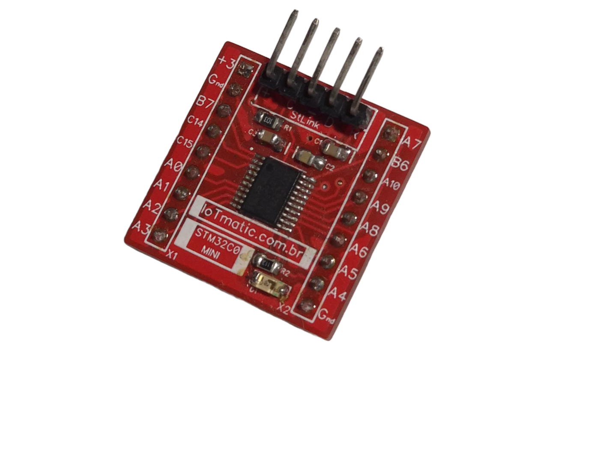

# Placa C0_MINI

A **C0_MINI** é uma placa de desenvolvimento ultracompacta desenvolvida pela [**IoTmatic.com.br**](https://iotmatic.com.br), baseada no microcontrolador **STM32C011F6P6** da STMicroelectronics. 

---

## ⚙️ Especificações Principais

* **Microcontrolador:** STM32C011F6P6 (ARM® Cortex®-M0+ até $48\text{ MHz}$, $32\text{ KB}$ Flash, $6\text{ KB}$ SRAM)
* **Fabricante da Placa:** [IoTmatic.com.br](https://iotmatic.com.br)
* **Interface de Programação/Debug:** Conector dedicado ST-Link (`+`, `C`, `-`, `D`, `R`)

---

## 🕒 Configuração de Clock

* **Fonte de Clock:** Oscilador interno HSI48 ($48\text{ MHz}$)
* **Prescaler de Sistema:** $/4$
* **Frequência do Core (SYSCLK):** $12\text{ MHz}$

---

## 📌 Mapeamento de Pinos e Periféricos

### **LED de Usuário**
* **LED Onboard:** Conectado ao pino **`PA4`**

### **Ajustes de Remapeamento de Pinos (Pinout)**
Devido às características de multiplexação do encapsulamento TSSOP-20 do STM32C011, o layout foi ajustado para expor as seguintes funções de comunicação:

| Pino Físico / Função Original | Ajuste / Mapeamento de Hardware | Periférico Utilizado |
| :---: | :---: | :--- |
| **`PA11`** | **`PA9`** | **USART1** (`TX`/`RX`) ajustada  |
| **`PA12`** | **`PA10`** | para `PA9` e `PA10` |

---

## 🖼️ Galeria de Placas (Top & Bottom)

| Vista Superior (Top PCB) | Vista Inferior (Bottom PCB) |
| :---: | :---: |
|  |  |

---

## 📄 Licença e Suporte

Projeto desenvolvido por **IoTmatic.com.br**. Sinta-se à vontade para utilizar e adaptar o firmware para suas aplicações embarcadas.
